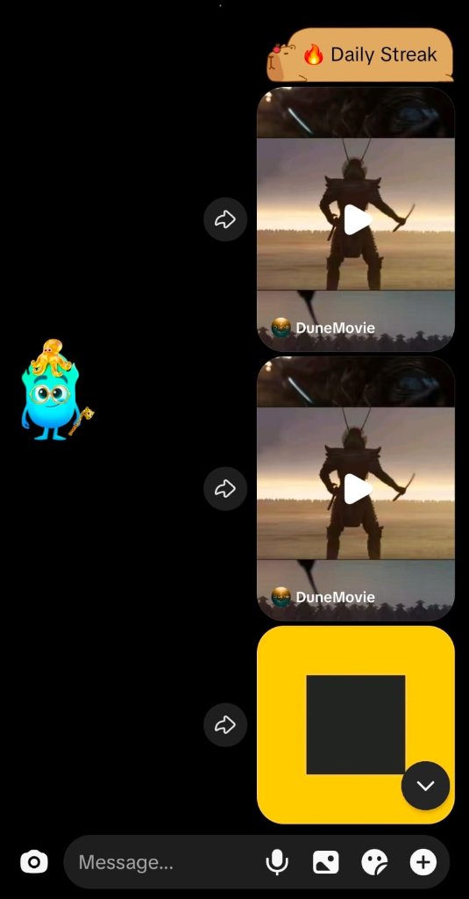
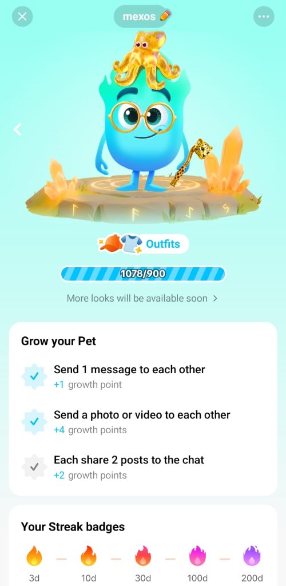
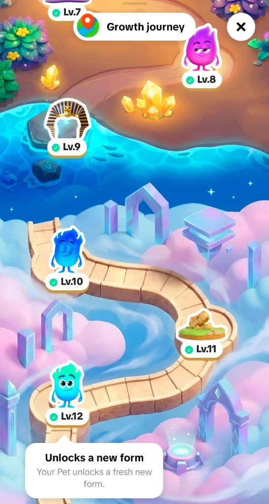
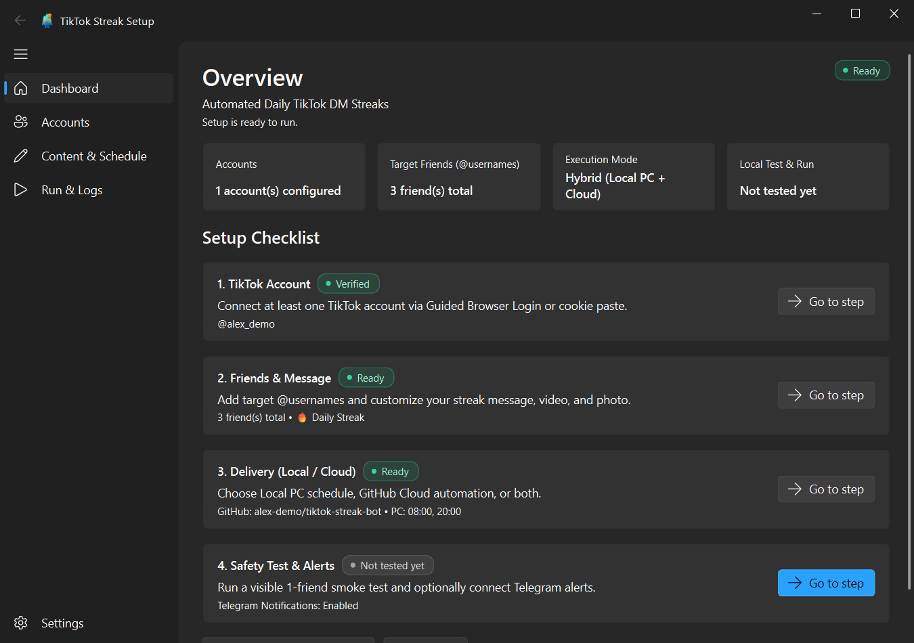
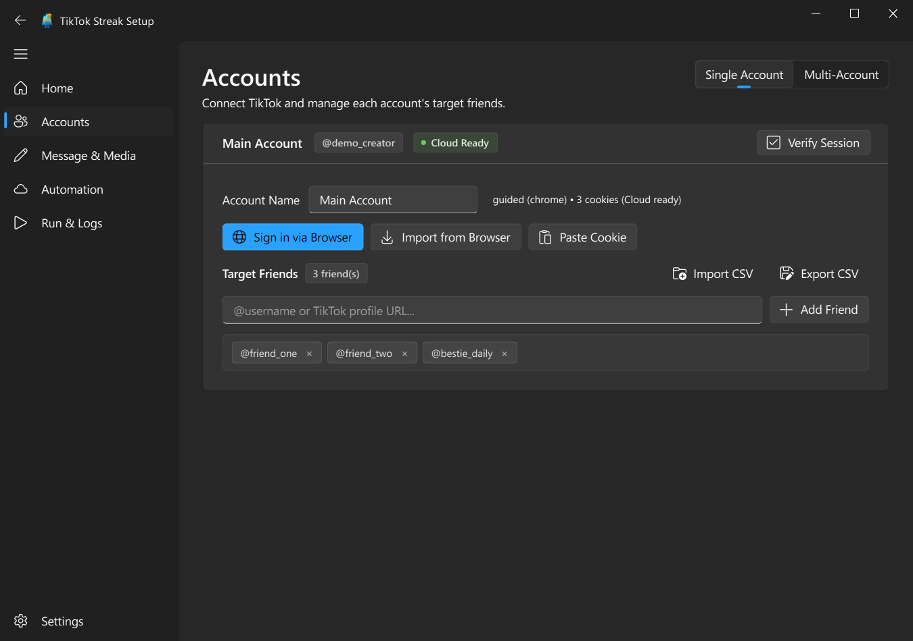
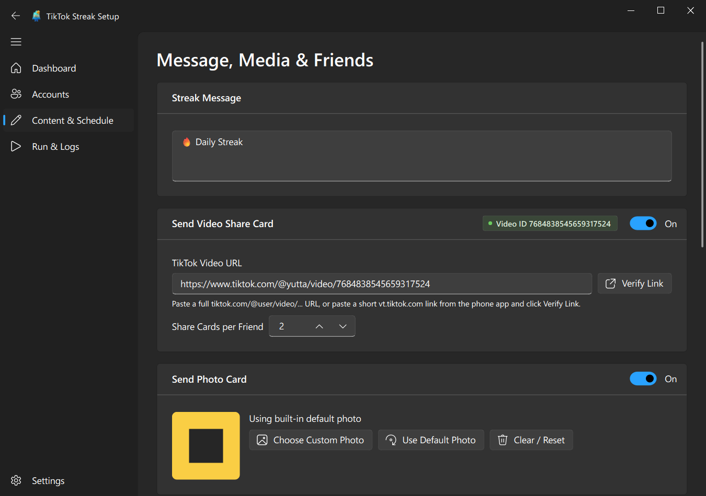
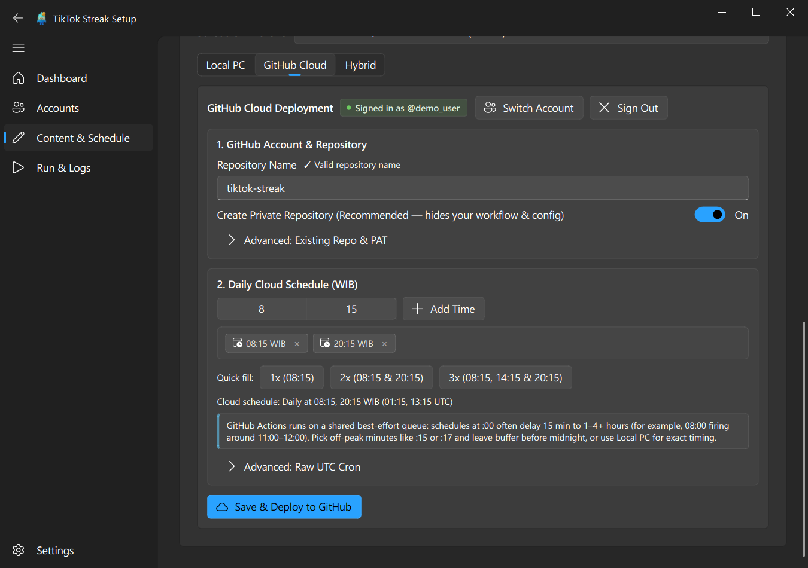
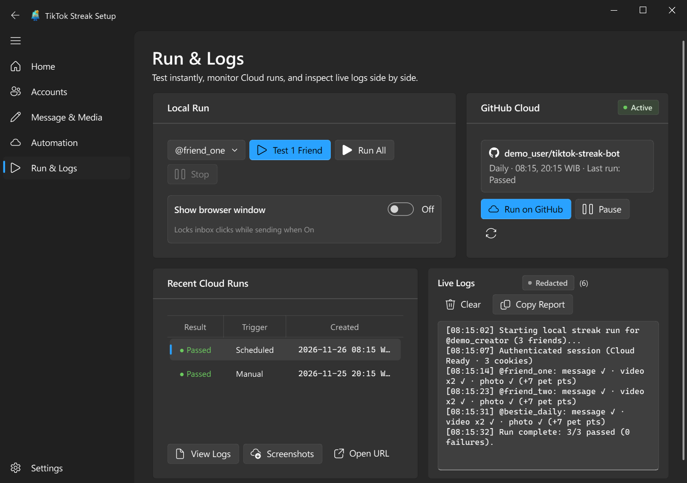
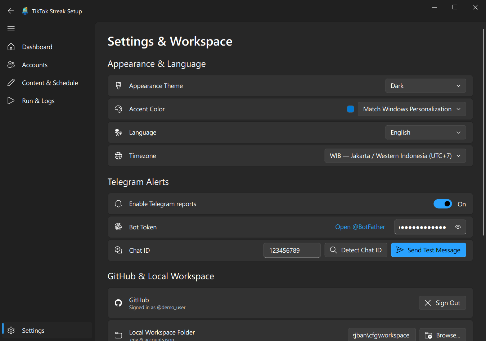

<div align="center">
  
  <h1>TikTok Streak Auto</h1>
  <p>Keep your TikTok DM streaks alive and level up your Streak Pet (forms, levels, and outfits) every day without captchas.</p>
  <p>
    Runs automatically via <strong>GitHub Actions</strong> with no paid server or VPS needed, or locally on Windows through the desktop app.
  </p>
  <p>
    <a href="https://github.com/alexanderfrit/tiktok-streak/releases/latest">Download Windows App (.exe)</a> &middot;
    <a href="#user-guide">User Guide</a> &middot;
    <a href="#developer-guide">Developer Guide</a> &middot;
    <a href="#how-it-works">How It Works</a>
  </p>
</div>

**Under the hood:**
- **Native Windows 11 Fluent GUI (`PySide6` + `PySide6-Fluent-Widgets`):** Uses `FluentWindow` with Windows Mica translucency, reads `HKCU\Software\Microsoft\Windows\DWM` for live system accent colors and Dark/Light theme switching (`WM_DWMCOLORIZATIONCOLORCHANGED`), and keeps `--run-bot` scheduled execution free of Qt imports.
- **Raw CDP login (`v20` bypass):** Launches your native `chrome.exe` / `msedge.exe` without ChromeDriver or `--enable-automation` and captures cookies via a one-shot stdlib RFC 6455 WebSocket (`Storage.getCookies`), avoiding Windows App-Bound Encryption (`v20`) blocks.
- **`/messages`-only stealth:** Never visits public profiles or video watch pages (`secsdk-captcha` trigger); patches `navigator.webdriver` pre-navigation and resets `sessionStorage` replay buffers between accounts.
- **In-page protobuf + `frontierSign`:** Hooks `im-ws` / `/v1/message/send` with an inline protobuf codec, borrows emitted `SEND_MESSAGE` frames to forge video-share cards (`aweType: 800`), and re-signs `X-Bogus` through `window.byted_acrawler.frontierSign`.
- **Serverless scheduling & zero-`git` cloud sync:** Uses GitHub Actions cron workflows to run on schedule without renting a server, bootstraps private repos via the Git Data API, seals secrets with `PyNaCl` (`SealedBox`), and stores local credentials in OS keyring / Windows DPAPI.

---

## What It Sends & Streak Pet Growth

Beyond keeping daily streak days alive, sending all three message types completes TikTok's daily **Grow your Pet** checklist (`+1` message, `+4` photo/video, `+2` for 2 shared posts) to level up your Pet and unlock outfits and new forms.

| Automated Chat Sequence | Daily Pet Tasks & Badges | Growth Journey |
|---|---|---|
|  |  |  |

- **Left:** Example output in a TikTok DM chat — sends **1 text message**, **2 shared video cards**, and **1 photo** in order per friend (each part is customizable or can be turned off).
- **Middle:** Those sends complete the daily **Grow your Pet** tasks (`+1` + `+4` + `+2` growth points) alongside streak milestones.
- **Right:** Earned growth points advance your Pet along the **Growth journey** (`Lv.` rewards, **Outfits**, and evolved forms).

---

## Preview

| Overview & Checklist | TikTok Accounts & Friends |
|---|---|
|  |  |

| Message & Media Cards | Cloud Schedule & Deployment |
|---|---|
|  |  |

| Run History & Logs | Settings & Windows Theme Sync |
|---|---|
|  |  |

---

## User Guide

Everything you need to set up and run daily streaks on Windows using `TikTokStreakSetup.exe`.

### 1. Download and Open

1. Open [Releases](https://github.com/alexanderfrit/tiktok-streak/releases/latest) and download **`TikTokStreakSetup.exe`**.
   - It is a single standalone executable — no `.zip` extraction or Python install needed.
2. Double-click `TikTokStreakSetup.exe` to open the app.
   - Windows SmartScreen may warn that the file is unsigned. Click **More info** -> **Run anyway**.

### 2. Connect Your TikTok Account (**Accounts** tab)

1. Click **Sign in via Browser (Recommended)** (uses Chrome or Edge on your PC).
   > **Why a new browser window opens:** Modern Chrome and Edge on Windows lock stored cookies with App-Bound Encryption (`v20`), so external apps cannot read `sessionid` straight off your disk. Guided Browser Login opens an isolated clean window without automation flags, lets you log in normally, and grabs your cookies as soon as `/messages` loads.
2. Sign in to TikTok in that window. Once your inbox appears, click **I'm Logged In — Grab Now** (or wait for it to detect `/messages` automatically).
   - You can also use **Import from Browser** (works on unlocked Chrome/Edge profiles and Firefox) or **Paste Cookie Manually**.
   - Business Suite accounts without `/messages` cannot send DM streaks and are flagged during verification.
3. Add your friends' usernames under **Target Friends (`@usernames`)**, or click **Import friends.csv**.
4. Switch **Multi-Account** on at the top right if you want to manage more than one TikTok account.

### 3. Pick Your Message, Media, and Schedule (**Content & Schedule** tab)

- **Message:** Set the daily message text sent to each friend (default: `🔥 Daily Streak`).
- **Video Share Card & Photo Card:** Keep the defaults, paste your own TikTok video URL or pick a custom photo, or toggle either switch off to send text only.
- **Delivery Mode:**
  - **Local PC (Windows Task Scheduler):** Runs automatically on your PC at the times you add under **Local Schedule** (your PC needs to be turned on at those times).
  - **Cloud (GitHub Actions):** Runs on GitHub's servers even while your PC is off.
    1. Click **Sign in with GitHub** and approve the browser login prompt (`repo` and `workflow` permissions).
    2. Keep **Create Private Repository** switched on so your bot repository and action logs stay private (or choose an existing repo with **Fetch My Repos**).
    3. Choose your daily **WIB** run time and click **Save & Deploy to GitHub**.
  - **Hybrid:** Combines both Local PC scheduling and GitHub Cloud runs.

### 4. Test With One Friend First (**Run & Logs** tab)

1. Pick one friend under **Select friend for 1-friend smoke test**.
2. Optionally switch on **Show browser window** if you want to watch it happen live.
3. Click **Quick Test (1 Friend, Visible)** to confirm your session and message flow work before running against everyone.
4. For cloud runs, check **GitHub Cloud Monitor** to run workflows on demand (**Run on GitHub Now**), inspect job logs, or download `debug-diagnostics` screenshots if anything fails.

### 5. Theme, Language, and Telegram Alerts (**Settings** tab)

- **Appearance & Language:** Syncs with Windows Dark/Light mode and Windows Personalization accent colors by default, with overrides for Light, Dark, or TikTok pink (`#fe2c55`), plus **English (`EN`)** and **Bahasa Indonesia (`ID`)** switching.
- **Telegram Alerts (Optional):** Create a bot via [`@BotFather`](https://t.me/BotFather), paste your token, send `/start` to your bot, click **Detect Chat ID**, and click **Send Test Message**.

### Troubleshooting

| Issue | Reason | Fix |
|---|---|---|
| Chrome / Edge profile shows `v20` | Windows App-Bound Encryption blocks reading cookies from disk | Use **Sign in via Browser (Recommended)** or **Paste Cookie Manually**. |
| `SessionExpiredError` | Saved `sessionid` expired or signed out | Run **Sign in via Browser** again and re-deploy secrets if using Cloud mode. |
| `InboxUnavailableError` | Account redirected to TikTok Business Suite without `/messages` | Switch to a standard personal TikTok account. |
| `DMBlockedError` / `UserNotFoundError` | Handle not found or DMs restricted | Double-check `@username` spelling and confirm a mutual thread exists in `/messages`. |
| `RateLimitError` | Too many messages sent in a short burst | Execution stops automatically; wait for cooldown or lower **Daily Friend Cap**. |
| Timeout / selector failure | Slow inbox load or DOM change | Select the failed run in **Run & Logs** -> **Download Debug Artifacts**. |

---

## Developer Guide

Technical overview, CLI usage, configuration schemas, and build pipeline.

### How It Works

1. **Inbox-Only Session Flow (`src/browser.py`)**
   - `init_browser()` launches Chrome with `--disable-blink-features=AutomationControlled`, `excludeSwitches: ["enable-automation"]`, `useAutomationExtension: False`, and a pre-document CDP script (`Page.addScriptToEvaluateOnNewDocument`) that hides `navigator.webdriver` and stubs `window.chrome.runtime`.
   - `authenticate_session()` visits `https://www.tiktok.com`, clears existing cookies plus stashed replay state (`sessionStorage.__tmplB64`, `__httpSendB64`, `__httpSendUrl`, `window.__sent`, `__recv`, `__httpSend`, `__mediaSend`), injects the account's cookies (`TIKTOK_COOKIES` defaults merged first, per-account payload last so multi-account sessions never bleed), and navigates directly to `MESSAGES_URL` (`https://www.tiktok.com/messages?allow_label=true&lang=en&scene=business`). Never loading public profile or video watch pages avoids `secsdk-captcha` challenges.
   - Immediately checks redirects for `/login` (`SessionExpiredError`) or `business-suite` (`InboxUnavailableError`) before wasting selectors downstream.

2. **Thread Resolution & Human Pacing (`src/actions.py`)**
   - `open_inbox_chat()` scans rendered conversation rows using `OPEN_THREAD_JS` (bidirectional display-name / handle match), falling back to `INBOX_SEARCH_CANDIDATES` inside the inbox search input rather than navigating outside `/messages`.
   - `send_streak_message()` dismisses blocking modals, focuses the composer (`MESSAGE_INPUT_CANDIDATES`), types character-by-character with randomized delays (`0.04s–0.12s`), submits with `Keys.RETURN`, inspects `data-e2e="toast"` / `role="alert"` banners for `RateLimitError`, and verifies the composer text cleared.

3. **Video Share Card Forging & Fallback (`src/share.py`)**
   - Installed via `Page.addScriptToEvaluateOnNewDocument` before `/messages` loads:
     - `WS_HOOK_JS` wraps `window.WebSocket` + `WebSocket.prototype.send` and records live sockets, sent frames (`__tmplB64`), and server echoes (`window.__recv`), alongside an inline binary protobuf codec (`window.__pb`).
     - `HTTP_SEND_HOOK_JS` intercepts `fetch` / `XMLHttpRequest` calls to `/v1/message/send` and `CommitImageUpload`, stashing request headers and serialized protobuf bodies (`__httpSendB64`).
   - `send_share_card()` queries video metadata (`fetch_item_detail`), constructs the card JSON (`build_share_json`, `aweType: 800`), borrows the latest captured `SEND_MESSAGE` protobuf frame, swaps payload fields (`item.f6 = 8`), refreshes `client_message_id` / `seqid` / `logid`, re-signs `X-Bogus` through the page's own `window.byted_acrawler.frontierSign`, and sends it on the live `im-ws` WebSocket while waiting for server confirmation. If the session used HTTP `/v1/message/send` without emitting a socket template, it falls back automatically to replaying the signed HTTP request (`_forge_http_async_js`).

4. **Photo Card Upload Verification (`src/photo_prep.py`, `src/share.py`)**
   - In GitHub Actions, `src.photo_prep` decodes base64 `PHOTO_DATA_URL` into `assets/custom_photo.<ext>` (or uses `PHOTO_PATH` / `assets/default_photo.png`) and writes `PHOTO_PATH` to `$GITHUB_ENV` (returning empty when `DISABLE_PHOTO` or `none`/`off`/`disabled` is set).
   - `install_media_guard()` captures TikTok's hidden `<input type="file">` as `#im-file-input-select` so Selenium sends the absolute image path without an OS file dialog, clicks Send in the preview modal, and treats network state (`CommitImageUpload` + 2xx `/v1/message/send`) and non-rejected DOM bubbles as ground truth.

5. **Native Browser Login (`v20` Workaround) & Cookie Scanning (`gui/services/tiktok_auth.py`, `gui/services/browsers.py`)**
   - `guided_browser_login()` resolves installed `chrome.exe` / `msedge.exe` via Windows `App Paths`, launches the real browser directly via `subprocess.Popen` with an isolated temporary user-data directory and `--remote-debugging-port` (no ChromeDriver binary, no `--enable-automation`, and no `Runtime.enable` during login), monitors `http://127.0.0.1:<port>/json/list` for `/messages` or `business-suite`, and captures cookies over a one-shot stdlib RFC 6455 WebSocket (`Storage.getCookies` with `Network.getAllCookies` fallback).
   - `browsers.py` reads Chromium `Local State` (`profile.info_cache`) and Firefox `profiles.ini` display names, copies locked SQLite + `-wal`/`-shm` sidecars into temporary files (`BrowserLocked` if exclusive lock persists), decrypts `v10`/`v11` AES-256-GCM cookies via DPAPI, and explicitly flags Windows App-Bound Encryption (`v20`) profiles.

6. **Local Persistence & Cloud Orchestration (`gui/services/storage.py`, `gui/services/github_api.py`, `gui/services/scheduler.py`)**
   - `ConfigStore` writes atomic JSON to `%APPDATA%\TikTokStreak\config.json`; `SecretStore` stores cookies and tokens in the OS keyring (`keyring`) with Windows DPAPI fallback and applies `redact_secrets()` before displaying or exporting logs.
   - `GitHub` client authenticates via Device Flow OAuth (`repo` + `workflow` scopes), creates or updates a private automation repository via the Git Data API (`blobs` -> `tree` -> `commit` -> ref — no local `git.exe` required), seals secrets with `PyNaCl` (`SealedBox`), removes stale secrets, rewrites UTC cron expressions in `.github/workflows/streak.yml`, and downloads workflow logs / `debug-diagnostics` archives.
   - `scheduler.py` registers daily Windows Task Scheduler tasks targeting `<TikTokStreakSetup.exe | pythonw run_gui.py> --run-bot`. In `--run-bot` mode, `run_gui.py` skips importing `PySide6` / `PySide6-Fluent-Widgets` entirely.

---

### Repository Layout

```text
tiktok-streak/
├── .github/workflows/
│   ├── streak.yml               # Automated cloud runner
│   └── build-exe.yml            # PyInstaller single-file Windows .exe release workflow
├── assets/
│   ├── app_icon.png             # Transparent app icon used at runtime
│   ├── app_icon.ico             # Multi-resolution Windows executable icon (16-256px)
│   └── default_photo.png        # Default photo card asset
├── docs/screenshots/            # GUI screenshots embedded in README
├── gui/
│   ├── app.py                   # FluentWindow shell, Windows theme listener, splash & nav
│   ├── workers.py               # QThread worker bridge with threading.Event cancellation
│   ├── pages/                   # Home, Accounts, Content & Schedule, Run & Logs, Settings
│   ├── services/                # Pure-Python backend (storage, i18n, validators, browsers, tiktok_auth, github_api, local_runner, scheduler, theme)
│   └── widgets/                 # AccountCard, StatusPill, FluentSpinBox, CookieDialog, DeviceLoginDialog, LogViewer
├── src/
│   ├── actions.py               # Inbox navigation, typing pacing, send verification
│   ├── browser.py               # Stealth Chrome/Edge launcher and session cookie injection
│   ├── config.py                # Single (.env) and multi-account (accounts.json) parser
│   ├── exceptions.py            # Classified exceptions with recovery guidance
│   ├── notifier.py              # Telegram notification sender (24h WIB formatting)
│   ├── photo_prep.py            # PHOTO_DATA_URL decoder and disable flag handling
│   └── share.py                 # WebSocket/HTTP video share and photo card sender
├── tests/
│   ├── test_core_and_services.py
│   └── test_fluent_gui.py
├── main.py                      # Headless/headful bot CLI & programmatic entry point
├── run_gui.py                   # Desktop app entry point (--smoke-test / --run-bot CLI)
├── fetch_friends.py             # Scrapes mutual handles from /messages into friends.csv
├── capture_share.py             # Captures share-card WebSocket/HTTP traffic
├── probe_sender_ready.py        # Probes byted_acrawler & im-ws readiness
├── test_runner.py               # Core & workflow self-check suite
├── requirements.txt             # Minimal CLI/CI runner dependencies
└── requirements-gui.txt         # Desktop GUI dependencies (PySide6-Fluent-Widgets, Pillow, PyNaCl, pywin32, keyring)
```

Dependencies are split so Linux GitHub Actions runners install only `requirements.txt`, while local desktop development and PyInstaller builds add `requirements-gui.txt`.

---

### Run From Source

Requires **Python 3.10+** (CI builds on **Python 3.11**) and Chrome or Edge.

```bash
git clone https://github.com/alexanderfrit/tiktok-streak.git
cd tiktok-streak

# CLI / headless runner only:
pip install -r requirements.txt

# Desktop GUI + CLI:
pip install -r requirements.txt -r requirements-gui.txt
python run_gui.py
```

`run_gui.py` CLI flags:
```powershell
python run_gui.py --smoke-test                              # Verify MainWindow startup & exit cleanly (headless-safe)
python run_gui.py --run-bot --headful                       # Run using saved GUI config/secrets with visible browser
python run_gui.py --run-bot --only-account Main --only-friend user1
```

---

### Manual Configuration (`.env` / `accounts.json`)

#### Option A: Single Account (`.env`)
Copy `.env.example` to `.env`:
```env
TIKTOK_SESSION_ID="your_sessionid_cookie_here"
MESSAGE="🔥 Daily Streak"
FRIENDS_LIST="friend_username_1, friend_username_2"

STREAK_VIDEO_URL="https://www.tiktok.com/@yutta/video/7684838545659317524"
SHARE_TIMES=2
PHOTO_PATH="assets/default_photo.png"

DAILY_CAP=0
DISABLE_VIDEO=false
DISABLE_PHOTO=false
HEADLESS=true

TELEGRAM_BOT_TOKEN=""
TELEGRAM_CHAT_ID=""
```
*(Accepts a raw `sessionid`, a `Cookie:` header string, or a JSON cookie export from DevTools -> Application -> Cookies -> `https://www.tiktok.com`.)*

#### Option B: Multi-Account (`accounts.json`)
Copy `accounts.example.json` to `accounts.json`:
```json
[
  {
    "name": "Main_Account",
    "session_id": "sessionid_cookie_1",
    "friends": ["friend_one", "friend_two"],
    "message": "🔥 Daily Streak",
    "video_url": "https://www.tiktok.com/@yutta/video/7684838545659317524",
    "share_times": 2,
    "photo_path": "assets/default_photo.png"
  },
  {
    "name": "Text_Only_Account",
    "session_id": "sessionid_cookie_2",
    "friends": ["another_friend"],
    "message": "🔥 Streak!",
    "share_times": 0,
    "photo_path": "none"
  }
]
```
- Omitted `video_url`, `share_times`, or `photo_path` fields inherit from `.env` / defaults.
- Setting `share_times: 0` or `video_url` / `photo_path` to `""`, `"none"`, `"off"`, or `"disabled"` turns off that media card for that account only.

#### Direct CLI Execution
```bash
python main.py                                              # Run configured mode (HEADLESS env controls visibility)
python main.py --headful                                    # Visible browser (--visible is an alias)
python main.py --headful --only-friend friend_username_1    # 1-friend smoke test
python main.py --headful --only-account Main_Account --only-friend friend_username_1
python fetch_friends.py                                     # Export mutual inbox handles into friends.csv
```

---

### GitHub Actions Secrets & Schedule Reference

`.github/workflows/streak.yml` reads these repository secrets:

| Secret Name | Scope | Purpose |
|---|---|---|
| `TIKTOK_SESSION_ID` | Single-account (required unless JSON set) | Cookie payload (`sessionid`, `Cookie:` header, or JSON array) |
| `FRIENDS_LIST` | Single-account (required unless JSON set) | Comma-separated friend handles |
| `MESSAGE` | Optional | Daily streak message text |
| `TIKTOK_COOKIES` | Optional | Global companion cookies (overridden per account by `session_id`) |
| `TIKTOK_ACCOUNTS_JSON` | Multi-account | JSON array matching `accounts.json` (takes precedence over `TIKTOK_SESSION_ID`) |
| `STREAK_VIDEO_URL` | Optional | Video share URL or ID (`none` to disable) |
| `SHARE_TIMES` | Optional | Share cards per friend (`0` to disable) |
| `PHOTO_DATA_URL` | Optional | Base64 data URL decoded by `src.photo_prep` before run |
| `PHOTO_PATH` | Optional | Repo-relative photo path (`none` to disable; default `assets/default_photo.png`) |
| `DAILY_CAP` | Optional | Max friends messaged per account per run (`0` = unlimited) |
| `DISABLE_VIDEO` | Optional | `true`/`1`/`yes` disables video share cards |
| `DISABLE_PHOTO` | Optional | `true`/`1`/`yes` disables photo cards |
| `TELEGRAM_BOT_TOKEN` | Optional | Telegram Bot API token |
| `TELEGRAM_CHAT_ID` | Optional | Target Telegram chat ID |

GitHub Actions cron runs in **UTC** (`UTC = WIB - 7 hours`):

| Schedule (WIB) | UTC Equivalent | `.github/workflows/streak.yml` `cron` |
|---|---|---|
| `08:00 WIB` daily | `01:00 UTC` | `'0 1 * * *'` |
| `08:00` & `20:00 WIB` | `01:00` & `13:00 UTC` | `'0 1,13 * * *'` |
| `08:00`, `14:00`, `20:00 WIB` | `01:00`, `07:00`, `13:00 UTC` | `'0 1,7,13 * * *'` |
| Every 6 hours | `00:00`, `06:00`, `12:00`, `18:00 UTC` | `'0 */6 * * *'` |

Windows Task Scheduler (`schtasks`) commands (`--run-bot`):
```powershell
schtasks /Create /TN "TikTokStreakDaily_0800" /TR "pythonw.exe C:\path\to\tiktok-streak\run_gui.py --run-bot" /SC DAILY /ST 08:00 /F
schtasks /Delete /TN "TikTokStreakDaily_0800" /F
```

---

### Testing & Building the Standalone `.exe`

Run the automated checks:
```powershell
python -B test_runner.py
$env:QT_QPA_PLATFORM="offscreen"; python -B run_gui.py --smoke-test
$env:QT_QPA_PLATFORM="offscreen"; python -B -m pytest -p no:cacheprovider tests/ -v
```

Build `dist/TikTokStreakSetup.exe` locally (same configuration as `.github/workflows/build-exe.yml`):
```powershell
pip install pyinstaller
pyinstaller --noconfirm --clean --windowed --onefile --noupx `
  --name TikTokStreakSetup `
  --icon assets/app_icon.ico `
  --add-data "assets;assets" `
  --add-data "src;src" `
  --add-data "main.py;." `
  --add-data "requirements.txt;." `
  --add-data "test_runner.py;." `
  --add-data ".github/workflows/streak.yml;.github/workflows" `
  --collect-all qfluentwidgets `
  --collect-all qframelesswindow `
  --collect-all keyring `
  --collect-all nacl `
  --collect-all selenium `
  --hidden-import win32crypt `
  --hidden-import win32cred `
  --hidden-import pywintypes `
  --hidden-import Crypto.Cipher.AES `
  --hidden-import PIL `
  --hidden-import dotenv `
  --exclude-module PySide6.QtWebEngineCore `
  --exclude-module PySide6.QtWebEngineWidgets `
  --exclude-module PySide6.QtPdf `
  --exclude-module PySide6.Qt3DCore `
  --exclude-module PySide6.QtQuick `
  run_gui.py
```

Pushing a `v*` tag triggers `.github/workflows/build-exe.yml`, builds and smoke-tests the standalone binary on Windows, and attaches `TikTokStreakSetup.exe` to the GitHub Release:
```bash
git tag -a v1.0.0 -m "Release v1.0.0"
git push origin v1.0.0
```

---

## License

MIT License
